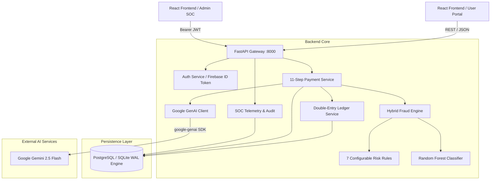

# RakshaPay — System Architecture Document
## AI-Powered Smart Payment Security & Fraud Prevention Platform

**Tagline**: *Pay Smart. Stay Protected.*  
**Category**: Financial Technology, Digital Payments, AI & Cyber Safety

---

## 1. High-Level Architecture Overview

RakshaPay is an AI-powered, simulated UPI payment security platform built on a clean monorepo architecture. It bridges deterministic financial security (ACID double-entry ledger, cryptographic idempotency keys, and zero-trust rules) with probabilistic machine learning and large language models (Google Gemini API).

---

## 2. Monorepo Organization

- **`frontend/`**: Single-Page Application (React 18, Vite 5, TypeScript 5, Tailwind CSS, Three.js, Recharts, Lucide Icons).
- **`backend/`**: RESTful API Gateway (FastAPI, SQLAlchemy 2.0, Pydantic v2, Python-Jose JWT, Uvicorn).
- **`ml/`**: Machine Learning pipeline (synthetic PaySim/UPI generator, feature preprocessing scaler, Random Forest model training, serialization to `.joblib`, and continuous inference).
- **`docs/`**: Complete system architecture, database schema, OpenAPI reference, and DFD Level 0, 1, 2 diagrams.
- **`scripts/`**: Automated database migration and demo data seeding (`seed_demo.py`).

---

## 3. Core Architectural Subsystems

### A. Double-Entry Accounting Ledger
- Every financial transaction represents a movement between two accounts.
- Amounts are strictly stored in **integer paise** (₹1.00 = 100 paise) to prevent IEEE 754 floating-point rounding errors.
- Every approved transfer generates **two balanced ledger entries** within an atomic database transaction:
  1. `DEBIT` on sender account (balance decreases by `X` paise).
  2. `CREDIT` on recipient account (balance increases by `X` paise).
- Pending, blocked, or failed transactions **never** execute ledger movements or alter account balances.

### B. Hybrid Fraud Detection Pipeline
1. **Rule Engine**: Deterministic scrutiny enforcing hard thresholds:
   - Velocity limit (max 3 transactions in 60s)
   - High value ceiling (> ₹50,000)
   - First-time recipient penalty
   - Community-reported scam recipient flag
   - Unusual late-night timing (00:00 - 05:00 hrs)
   - Spending spike deviation (> 4.0x historical average)
2. **Scikit-Learn Classifier**: Trained Random Forest model providing behavioral anomaly scoring (0 to 100).
3. **Threshold Decision Matrix**:
   - `0 - 29`: **APPROVED** (Transfer committed to ledger).
   - `30 - 69`: **PENDING** (Held for secondary verification).
   - `70 - 100`: **BLOCKED** (Rejected, security alert generated).

### C. Google Gemini Integration
- **Feature 1: AI Fraud Explanation**: Explains why a transaction was flagged using only verified telemetry signals.
- **Feature 2: Scam Message Analyzer**: Inspects pasted untrusted text (SMS, WhatsApp, UPI collect notes) for phishing indicators and social engineering.
- **Feature 3: AI Security Assistant**: Real-time interactive fintech safety advisor tailored to authenticated user context.
- **Prompt Injection Defense**: All user-submitted text is wrapped in strict boundary delimiters and treated as untrusted data.
- **Graceful Offline Fallback**: Deterministic heuristic fallbacks activate automatically if the Gemini API key is missing or quota is exhausted.

---

## 4. Security Principles

1. **Least Privilege & RBAC**: Admin endpoints are gated by server-side role verification (`role == 'admin'`).
2. **Idempotency**: Client-generated idempotency keys prevent duplicate debits during network retries.
3. **Password Security**: Passwords are never stored in plaintext; hashed using `passlib` with `bcrypt`.
4. **Zero-Trust Input Validation**: Pydantic schemas enforce type validation on all request payloads.
5. **Immutable Audit Logging**: Administrative actions and payment states are logged to an append-only audit table with actor IDs and IP addresses.
