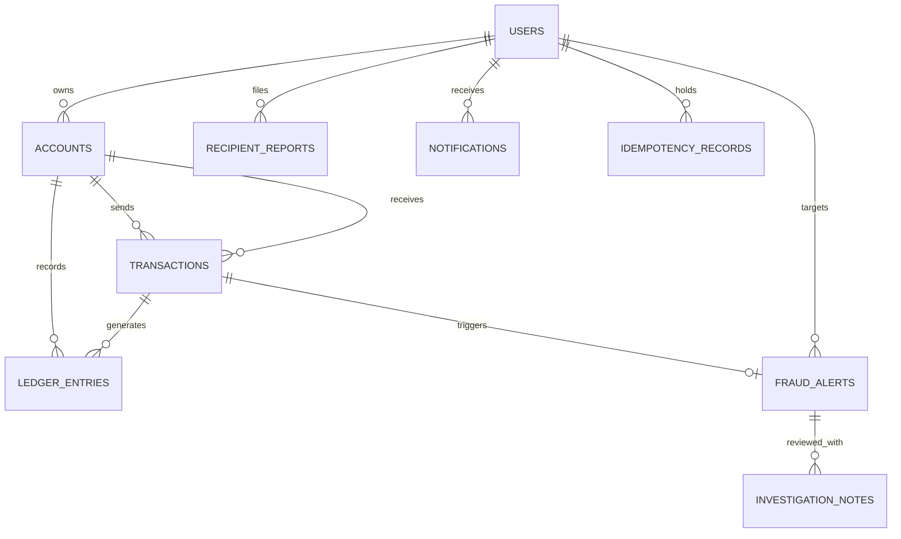

# RakshaPay — Database Schema Specification
## Relational PostgreSQL Schema & Double-Entry Ledger

---

## 1. Entity Relationship Overview

The database uses a normalized relational architecture with 12 distinct tables, strict foreign key constraints, and monetary balance integrity in **integer paise**.

---

## 2. Table Definitions

### 1. `users`
| Column | Type | Constraints | Description |
| :--- | :--- | :--- | :--- |
| `id` | VARCHAR(36) | PRIMARY KEY | Unique UUID identifier |
| `phone` | VARCHAR(20) | UNIQUE, INDEX, NOT NULL | Mobile number with country code |
| `full_name` | VARCHAR(100) | NOT NULL | User's full legal/display name |
| `email` | VARCHAR(100) | UNIQUE, INDEX, NULLABLE | User email address |
| `password_hash` | VARCHAR(255) | NULLABLE | Bcrypt password hash (for admin/dev login) |
| `role` | VARCHAR(20) | NOT NULL, DEFAULT 'user' | `'user'` or `'admin'` |
| `status` | VARCHAR(20) | NOT NULL, DEFAULT 'active' | `'active'`, `'suspended'`, or `'pending'` |
| `is_demo` | BOOLEAN | DEFAULT TRUE | Indicates simulated demonstration profile |
| `created_at` | TIMESTAMP | NOT NULL | UTC registration timestamp |
| `updated_at` | TIMESTAMP | NOT NULL | Last update timestamp |

### 2. `accounts`
| Column | Type | Constraints | Description |
| :--- | :--- | :--- | :--- |
| `id` | VARCHAR(36) | PRIMARY KEY | Unique account UUID |
| `user_id` | VARCHAR(36) | FOREIGN KEY (users.id) | Account owner |
| `upi_id` | VARCHAR(100) | UNIQUE, INDEX, NOT NULL | Simulated UPI handle (e.g. `rohit@raksha`) |
| `account_number`| VARCHAR(20) | UNIQUE, NOT NULL | Virtual core banking account number |
| `ifsc_code` | VARCHAR(11) | NOT NULL, DEFAULT 'RAKS0001001' | Virtual bank routing code |
| `balance_paise` | BIGINT | NOT NULL, DEFAULT 0 | Balance in integer paise (₹1 = 100 paise) |
| `currency` | VARCHAR(3) | NOT NULL, DEFAULT 'INR' | Account currency code |
| `status` | VARCHAR(20) | NOT NULL, DEFAULT 'ACTIVE' | `'ACTIVE'`, `'FROZEN'`, `'CLOSED'` |

### 3. `transactions`
| Column | Type | Constraints | Description |
| :--- | :--- | :--- | :--- |
| `id` | VARCHAR(36) | PRIMARY KEY | Unique transaction UUID |
| `transaction_ref`| VARCHAR(40) | UNIQUE, INDEX, NOT NULL | Human-readable reference (e.g. `RAKSHA-20261114-A7F2D`) |
| `sender_account_id`| VARCHAR(36) | FOREIGN KEY (accounts.id) | Debit account |
| `recipient_account_id`| VARCHAR(36)| FOREIGN KEY (accounts.id) | Credit account (if internal) |
| `recipient_upi_id` | VARCHAR(100)| INDEX, NOT NULL | Destination UPI handle |
| `recipient_name`| VARCHAR(100) | NOT NULL | Recipient display name |
| `amount_paise` | BIGINT | NOT NULL | Transaction amount in integer paise |
| `status` | VARCHAR(20) | INDEX, NOT NULL | `'APPROVED'`, `'PENDING'`, `'BLOCKED'`, `'FAILED'` |
| `risk_score` | INTEGER | NOT NULL | Composite risk score (0 to 100) |
| `risk_category`| VARCHAR(20) | NOT NULL | `'LOW'`, `'MEDIUM'`, `'HIGH'` |
| `decision_reason`| TEXT | NULLABLE | Human-readable explanation of decision |
| `risk_signals` | TEXT (JSON) | NULLABLE | JSON array of detected threat signals |
| `note` | VARCHAR(255) | NULLABLE | Optional payment remark |
| `idempotency_key`| VARCHAR(100)| UNIQUE, INDEX, NOT NULL | Client-supplied deduplication key |

### 4. `ledger_entries`
| Column | Type | Constraints | Description |
| :--- | :--- | :--- | :--- |
| `id` | VARCHAR(36) | PRIMARY KEY | Unique ledger UUID |
| `transaction_id`| VARCHAR(36) | FOREIGN KEY (transactions.id) | Associated transaction |
| `account_id` | VARCHAR(36) | FOREIGN KEY (accounts.id) | Affected account |
| `entry_type` | VARCHAR(10) | NOT NULL | `'DEBIT'` or `'CREDIT'` |
| `amount_paise` | BIGINT | NOT NULL | Amount moved in paise |
| `balance_after_paise`| BIGINT | NOT NULL | Snapshot of account balance post-operation |

### 5. `recipients`
| Column | Type | Constraints | Description |
| :--- | :--- | :--- | :--- |
| `id` | VARCHAR(36) | PRIMARY KEY | Directory entry UUID |
| `upi_id` | VARCHAR(100) | UNIQUE, INDEX, NOT NULL | Recipient handle |
| `name` | VARCHAR(100) | NOT NULL | Entity name |
| `account_age_days`| INTEGER | NOT NULL, DEFAULT 30 | Simulated account age |
| `risk_level` | VARCHAR(20) | NOT NULL, DEFAULT 'LOW' | `'LOW'`, `'MEDIUM'`, `'HIGH'` |
| `report_count` | INTEGER | NOT NULL, DEFAULT 0 | Number of user reports filed |
| `verification_status`| VARCHAR(30) | NOT NULL | `'SIMULATED_VERIFIED'`, `'UNVERIFIED'`, `'FLAGGED_SUSPICIOUS'` |
| `risk_indicators`| TEXT (JSON) | NULLABLE | Array of known threat flags |

### 6. `fraud_alerts`
| Column | Type | Constraints | Description |
| :--- | :--- | :--- | :--- |
| `id` | VARCHAR(36) | PRIMARY KEY | Unique alert UUID |
| `transaction_id`| VARCHAR(36) | FOREIGN KEY (transactions.id) | Flagged transaction (if any) |
| `user_id` | VARCHAR(36) | FOREIGN KEY (users.id) | Target user |
| `risk_score` | INTEGER | NOT NULL | Telemetry risk score (0-100) |
| `severity` | VARCHAR(20) | NOT NULL | `'LOW'`, `'MEDIUM'`, `'HIGH'`, `'CRITICAL'` |
| `signals` | TEXT (JSON) | NULLABLE | Detected signal vector |
| `explanation` | TEXT | NULLABLE | Rule explanation |
| `gemini_analysis`| TEXT (JSON) | NULLABLE | Google Gemini threat breakdown payload |
| `status` | VARCHAR(20) | INDEX, NOT NULL | `'NEW'`, `'UNDER_REVIEW'`, `'RESOLVED'`, `'DISMISSED'` |

### 7. `investigation_notes`
| Column | Type | Constraints | Description |
| :--- | :--- | :--- | :--- |
| `id` | VARCHAR(36) | PRIMARY KEY | Note UUID |
| `alert_id` | VARCHAR(36) | FOREIGN KEY (fraud_alerts.id) | Target fraud alert |
| `admin_id` | VARCHAR(36) | FOREIGN KEY (users.id) | Authoring SOC analyst |
| `note` | TEXT | NOT NULL | Analyst findings and forensic notes |
| `status_change`| VARCHAR(50) | NULLABLE | New alert status if updated |

### 8. `audit_logs`
| Column | Type | Constraints | Description |
| :--- | :--- | :--- | :--- |
| `id` | VARCHAR(36) | PRIMARY KEY | Audit UUID |
| `actor_id` | VARCHAR(36) | INDEX, NULLABLE | ID of user or admin taking action |
| `actor_role` | VARCHAR(20) | NOT NULL | `'user'`, `'admin'`, `'system'` |
| `action` | VARCHAR(100) | INDEX, NOT NULL | Action string (e.g. `PAYMENT_APPROVED`, `USER_STATUS_SUSPENDED`) |
| `target_type` | VARCHAR(50) | NOT NULL | Target entity type (`transaction`, `user`, `fraud_alert`) |
| `target_id` | VARCHAR(100) | NULLABLE | Target entity ID |
| `ip_address` | VARCHAR(50) | NULLABLE | Client IP address |
| `details_json`| TEXT (JSON) | NULLABLE | Action metadata payload |

### 9. `idempotency_records`
| Column | Type | Constraints | Description |
| :--- | :--- | :--- | :--- |
| `id` | VARCHAR(36) | PRIMARY KEY | Record UUID |
| `key` | VARCHAR(128) | UNIQUE, INDEX, NOT NULL | Client idempotency key |
| `user_id` | VARCHAR(36) | FOREIGN KEY (users.id) | Originating user |
| `request_hash` | VARCHAR(64) | NOT NULL | Fingerprint of request parameters |
| `response_code`| INTEGER | NULLABLE | HTTP status code of completed response |
| `response_body`| TEXT | NULLABLE | Cached response body for replay |
| `expires_at` | TIMESTAMP | INDEX, NOT NULL | Cache expiry (24 hours) |

### 10. `recipient_reports`
User-submitted fraud reports against suspicious UPI handles with reason, details, and review status.

### 11. `payment_requests`
Simulated collect requests between users with expiry timestamps.

### 12. `notifications`
User alert notifications for payments, blocked transfers, and platform announcements.
