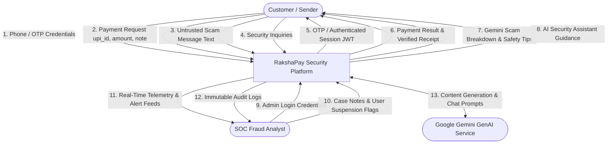

# Data Flow Diagram (DFD) — Level 0 (Context Diagram)
## RakshaPay Platform Context

The Level 0 context diagram represents the boundaries of the RakshaPay system, external entities interacting with the application, and the primary data streams.

### External Entities:
1. **Customer / Sender**: Initiates simulated payments, inspects recipient risk, pastes scam messages, and queries security assistant.
2. **SOC Fraud Analyst**: Reviews flagged fraud alerts, investigates suspicious transactions, soft-suspends anomalous accounts, and records findings.
3. **Google Gemini GenAI Service**: Analyzes untrusted text for phishing patterns and explains risk vectors in plain English.
