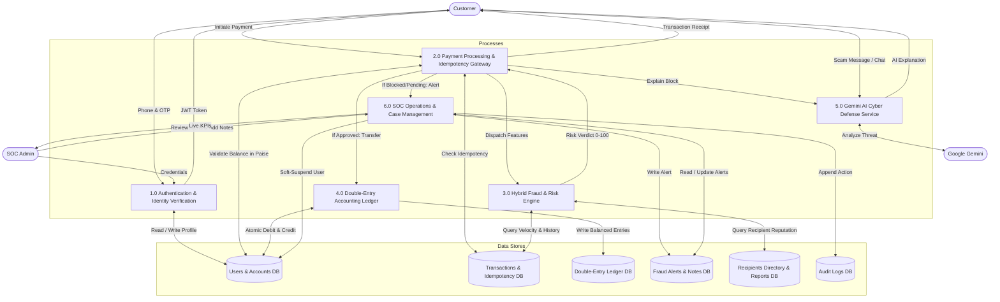

# Data Flow Diagram (DFD) — Level 1
## Subsystem Decomposition

The Level 1 diagram decomposes RakshaPay into its five primary operational subsystems and their interactions with system datastores.

