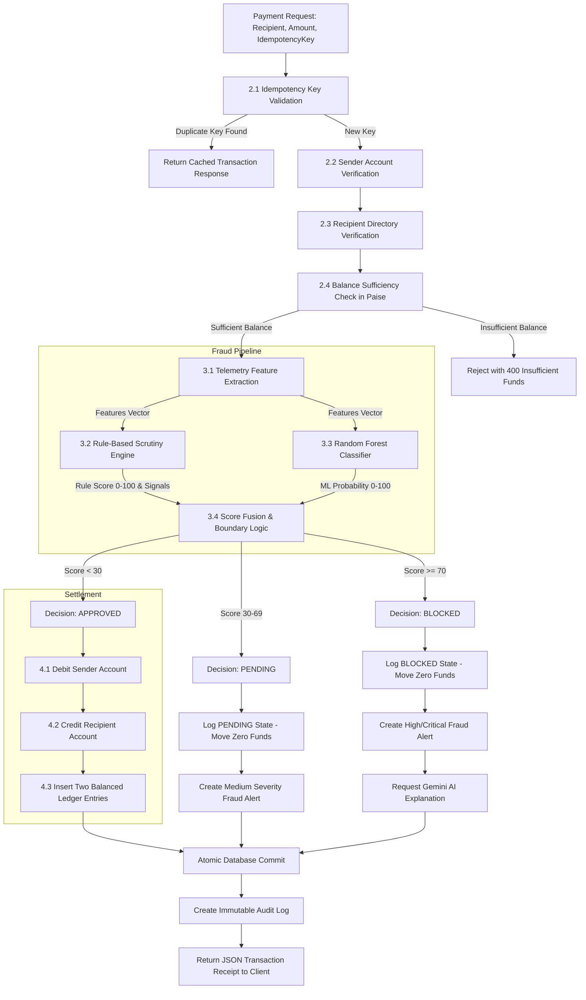

# Data Flow Diagram (DFD) — Level 2
## Detailed Payment Validation, Fraud Scoring & Settlement Process

The Level 2 diagram explodes process **2.0 (Payment Processing)** and **3.0 (Fraud Detection)** into their individual atomic micro-steps.

